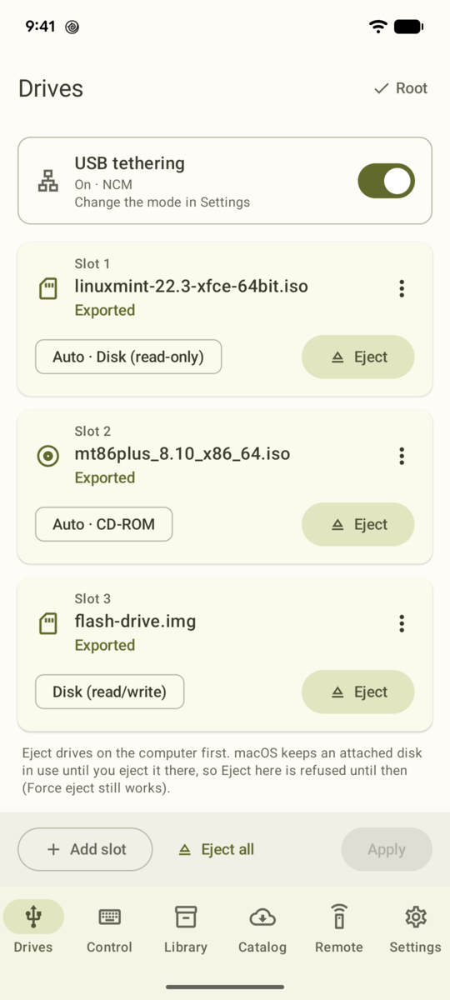
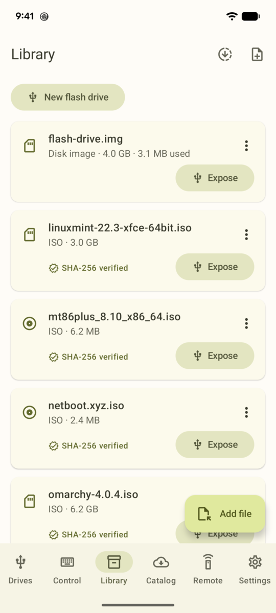
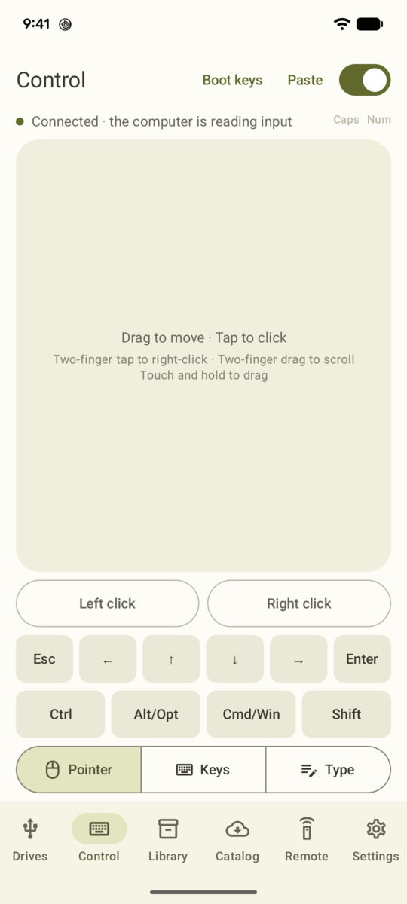
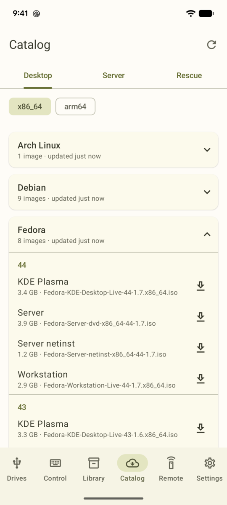
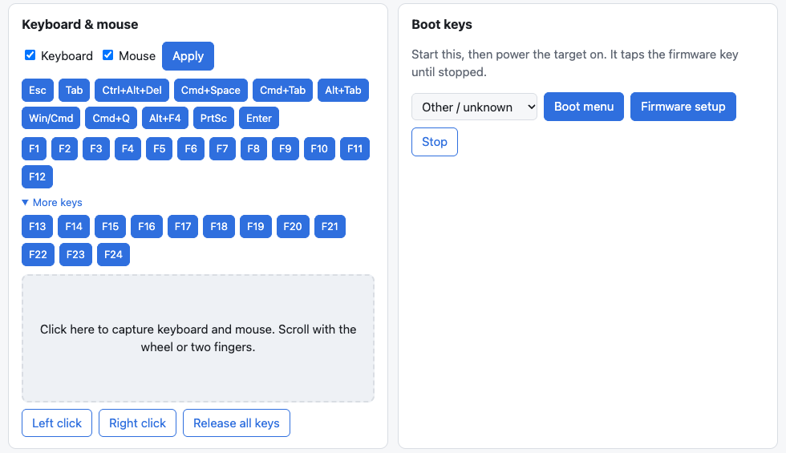

# Bootleg

**Your phone, as a USB stick, keyboard and mouse - for any computer.**

Plug a rooted Android phone into a computer and Bootleg makes it show up as bootable drives, a
keyboard and mouse, and a network adapter. Boot an installer from a phone full of ISOs, mash F12
at a BIOS boot menu, or share the phone's internet. You can do all of it from the phone, or from
another computer over Tailscale.

<table>
  <tr>
    <td align="center"><b>Drives</b></td>
    <td align="center"><b>Library</b></td>
    <td align="center"><b>Keyboard &amp; mouse</b></td>
    <td align="center"><b>Catalog</b></td>
  </tr>
  <tr>
    <td><picture><source media="(prefers-color-scheme: dark)" srcset="docs/screenshots/drives_dark.png"></picture></td>
    <td><picture><source media="(prefers-color-scheme: dark)" srcset="docs/screenshots/library_dark.png"></picture></td>
    <td><picture><source media="(prefers-color-scheme: dark)" srcset="docs/screenshots/control_dark.png"></picture></td>
    <td><picture><source media="(prefers-color-scheme: dark)" srcset="docs/screenshots/catalog_dark.png"></picture></td>
  </tr>
</table>

## What it does

### 💿 Bootable drives

Expose up to 8 ISO or IMG files at once, each as a CD-ROM, a read-only disk or a writable disk.
Boot installers and live systems, or carry a writable "flash drive" around on your phone. Swap the
image in a drive without reconnecting USB.

- **Catalog.** Browse current releases of popular distros and download them with SHA-256
  verification. The list comes live from each project's own release data:
  - Desktop: Ubuntu, Fedora, Debian, Mint, Pop!_OS, openSUSE, Arch, NixOS and Omarchy.
  - Server: Ubuntu Server, Debian netinst, Alpine, Rocky, AlmaLinux, Proxmox VE and TrueNAS.
  - Rescue: SystemRescue, GParted, Clonezilla, Memtest86+, ShredOS and netboot.xyz.
- **Blank images.** Create raw, FAT32, exFAT or ext4 images to use as writable drives or install
  targets.

### ⌨️ Keyboard and mouse

A BIOS-compatible USB keyboard and mouse, so it works in firmware setup and boot menus too:

- a touchpad with two-finger scrolling, or a plain boot mouse for picky firmware;
- sticky Ctrl, Alt (Option), Cmd (Win) and Shift, F1–F24, and shortcuts;
- boot-menu key presets for each PC vendor;
- paste-as-typing, to type a long command or password into a machine with no network.

### 🌐 USB tethering

Share the phone's internet with the computer over the same cable, alongside the drives, keyboard
and mouse. Bootleg brings its own network adapter: **NCM** (the default; macOS, Linux and Windows
10 2004 or later) or **RNDIS** (older Windows), picked in Settings. Turning tethering on or off
never reconnects USB, so it doesn't interrupt a mounted drive.

### 🛰️ Remote control

Turn the phone into a tiny KVM you can reach from anywhere. The phone runs an embedded Tailscale
node (it doesn't use Android's VPN slot), and any approved device on your tailnet can use the web
UI or the `bootleg` CLI to:

- mount and eject images;
- type, move the mouse and send boot keys;
- turn USB tethering on or off;
- start catalog downloads.

No internet where you are? The phone can host its own Wi-Fi hotspot and pair with a browser or
the CLI using a one-time code.

Every new device needs your approval on the unlocked phone, only one session is in control at a
time, and writable disks need a separate per-device permission.



## Requirements and tested hardware

> [!IMPORTANT]
> Bootleg is developed and tested on **one phone**: a **Google Pixel 6** (oriole) running
> **Android 17** (API 37, kernel 6.1), rooted with **Magisk**, with SELinux enforcing. The
> automated end-to-end checks use a Mac as the USB host.
>
> Other phones may work if they're rooted and their kernel has configfs USB gadget support
> (`mass_storage`, `hid` and, for NCM tethering, `ncm`), but they haven't been tried. USB
> gadget drivers differ between kernels, so expect rough edges elsewhere.

## Safety

- **Your phone's USB stays yours.** Bootleg only touches USB gadget entries with `bootleg` in
  their name. It never removes ADB or other apps' functions.
- **Recovery.** Every change is planned, applied, read back and checked. An independent timer
  restores USB if Bootleg dies mid-change. Optionally, your drives and tethering come back after
  a reboot.
- **Remote control** is opt-in, approval-based and releases every key when a session ends.

## Building

Toolchains come from [mise](https://mise.jdx.dev). The Android SDK goes in `.android-sdk/`.

```sh
mise install
mise exec -- sdkmanager --sdk_root=$PWD/.android-sdk "platform-tools" "platforms;android-37.1" "build-tools;37.0.0" "ndk;30.0.16248370"
echo "sdk.dir=$PWD/.android-sdk" > local.properties
mise run check     # lint, unit/property/simulation tests, screenshot tests, Go tests, build
mise run deploy    # install the debug build on the connected phone and grant root through Magisk
```

`mise run remote:cli` builds the `bootleg` CLI into `build/bin/`.

## Docs

- [SPEC.md](SPEC.md): requirements and decisions.
- [ARCHITECTURE.md](ARCHITECTURE.md): design, device facts, the USB gadget ownership rules and
  hard limits.
- [remote/PROTOCOL.md](remote/PROTOCOL.md): the remote-control protocol.
- [AGENTS.md](AGENTS.md): how to build, verify and contribute (the full verification ladder,
  including the on-phone checks), for humans and coding agents.

## License

[MIT](LICENSE)
